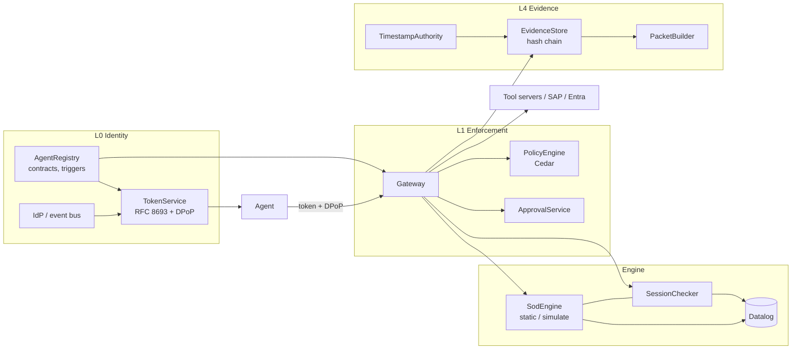

# Architecture

The system is only as trustworthy as the line between what an LLM proposes and what the engine decides. This package is the engine side of that line: everything that produces a verdict, enforces it, or records it.

## Scope of this release

The spec's delivery plan builds the deterministic core and the gateway first, so that "agents land only after the engine can veto them". `0.1.0` covers:

| Spec phase | Delivered |
| --- | --- |
| Phase 0 (core) | Principal/role model, SAP S/4HANA and Entra ID read connectors, Datalog SoD engine (static and simulation checks), hash-chained evidence store |
| Phase 1 (gateway and identity) | RFC 8693 token exchange with `act` claims, DPoP, Cedar policies, approval service, session SoD, plus tests for all four abuse cases and the latency gates |

## Layers



The gateway is the only path from an agent to a target system. Agent processes reach it over HTTP with `RemoteAgentClient` (`agents/client.py`), which holds the agent's own key and nothing else; `lint-imports` keeps agent code from importing the runtime or any module that holds a service key. The in-process `AgentClient` is for tests and the demo. The orchestrator and agents (L2/L3, Phase 2+) are not part of this release. The gateway already enforces what the spec requires of them: tool allow-lists, autonomy ceilings, the quarantine, and rejecting outputs that assert a verdict without an engine `result_ref`.

## The per-call pipeline

`Gateway.handle` (`src/agent_governance/gateway/gateway.py`) runs the spec's six steps in order:

1. **Token.** Verify the ES256 access token (issuer, audience = this tool server, ≤ 5 min lifetime, revocation list). Verify the DPoP proof's method, URL, `ath` and `jti` replay, and check that its key thumbprint equals `cnf.jkt`.
2. **Contract.** The tool must be in the token's `scope` *and* the agent contract's `allowed_tools`, and the agent must not be retired.
3. **Delegator.** Resolve the innermost principal of the `act` chain: an active human with their entitlements, or an enabled trigger with its owner-approved envelope.
4. **SoD.** For write tools: run session SoD on the executed-step history (plan scope ∪ 24 h window per delegator), and/or simulate the requested roles against the target principal. The result is written as a `sod.verdict` record whose id is the `result_ref`.
5. **Approval tier and Cedar.** The tier is the strictest of: the tool's base tier, the SoD outcome, the agent's autonomy (`write_with_approval` ⇒ at least line manager), injection flags (⇒ high risk), and bulk size (> 25 lines ⇒ bulk revoke). Cedar evaluates with the presented approvals. If it denies, it evaluates again with a hypothetical valid approval for this exact payload, and permission then means `require_approval`, which opens an approval task.
6. **Evidence, then forward.** The `gateway.decision` record is appended before the backend is called. Executed SoD-relevant steps are recorded after the target confirms. Check, forward and record are serialised per delegator.

## SoD engine

`sod/datalog.py` is a small semi-naive Datalog evaluator with stratified negation. It keeps one derivation per derived fact, so `Model.explain(fact)` returns the proof tree. The assignment program (`sod/engine.py`) is:

```
role_missing(R,S,A)   :- role_system(R,S), action_permission(S,A,O,F,V), not has_perm(R,S,O,F,V).
role_action(R,S,A)    :- role_system(R,S), action_exists(S,A), not role_missing(R,S,A).
principal_function(P,Fn,R,S,A) :- assigned(P,R), role_action(R,S,A), function_action(Fn,S,A).
sod_violation(P,K)    :- risk(K,_,Fa,Fb), principal_function(P,Fa,…), principal_function(P,Fb,…).
sod_violation(P,K)    :- critical_risk(K,_,F), principal_function(P,F,…).
```

A role grants an action only if it holds **every** required authorization, which is the universal quantification SAP authorizations need. `has_perm` is computed outside Datalog because it needs wildcard matching (`*`, `FB*`). Each violation carries a path of (function, role, system:action, satisfied authorizations), and the proof tree bottoms out in base facts.

Session SoD (`sod/session.py`) uses the same rule set. It pre-filters executed steps to those related to the proposal under at least one risk's `join_keys`, then derives `session_violation` in Datalog. p95 is about 40 ms on a 10k-step window, against a 150 ms target.

## Identity

- **Agent registry.** Contract fields as in the spec: `agent_id`, `version`, `owner` (a human), `model_ref`, `allowed_tools`, `risk_tier`, `max_autonomy`, `eval_status` and `retired_at`, plus the agent's public JWK. Quarantine drops autonomy to `read`, and only the owner can restore.
- **Eval status.** It caps what an agent version may do, both when tokens are issued and on every call, so a status change applies to tokens already out. `pending` and `failed` agents are read-only. A `shadow` agent keeps its contract autonomy, but its non-read calls are evaluated and recorded with the `shadow` flag, and never executed: no approval task is opened, no approval is spent and no step counts toward session SoD. Only the owner can change the status, and the change is recorded as evidence.
- **Token exchange.** On-behalf-of (`act = {sub: user}`) and triggered (`act = {sub: trigger:<id>}`). Autonomous exchange is refused. Scope = requested ∩ contract ∩ tools on the audience server ∩ autonomy (∩ trigger envelope). Hand-offs nest `act`, keep the `plan_id`, are capped at depth 3 and forbid loops.
- **Triggers.** Registered with a fixed envelope that the named human owner approved, optionally limited to a list of agents. Disabling a trigger stops both new tokens and calls made with existing ones.
- **Hand-offs.** Allowed only to agent IDs listed in the delegating agent's `may_delegate_to`.

## Evidence

Records are linked on a **content digest**: `hash_i = sha256(prev_hash_i ∥ digest(content_i))`, with a genesis hash per (tenant, day). An auditor packet therefore carries the full records for the selected control and only the digests of every other record that day. That is enough to recompute the chain to the anchored root without disclosing unrelated decisions. SQLite triggers block `UPDATE` and `DELETE`. Edits that bypass them are caught by `verify()`, and a consistent rewrite of a whole day is caught by the anchor.

## Deviations from the spec

Each of these is deliberate and covered by tests.

| Spec | This release | Why |
| --- | --- | --- |
| Soufflé Datalog | Embedded Python Datalog with derivation tracking | The spec allows "an embedded equivalent". Proof paths are first-class and there is no C++ toolchain. Latency targets are met. |
| Cedar `ActionGroup::"grant"` | `Action::"class:grant"` (and `class:read`, `class:draft`, `class:write`, `class:revoke`) | Cedar action groups must be entities of type `Action`. |
| `sub = agent`, `act = {sub: user}` | As specified | RFC 8693 puts the *actor* in `act`. The spec deliberately inverts this so `sub` always names the caller being authorized. Documented in `identity/sts.py`. |
| Postgres + Iceberg/S3 Object Lock | SQLite reference backends behind protocols (`EvidenceSink`, `SessionStore`) | Zero-infrastructure tests and demo. Production adapters are follow-ups. |
| RFC 3161 anchoring | `TimestampAuthority` protocol with a local Ed25519 implementation | The token format verifies offline. An RFC 3161 client implements the same protocol. |
| Signed PDF + JSON packet | Signed JSON bundle + Markdown cover sheet | The JSON is the evidence. Rendering to PDF adds a dependency without adding assurance. |
| Envoy + MCP proxy | In-process gateway with a FastAPI MCP surface | Same pipeline. Envoy can front it as an ext_authz or proxy layer. |
| Approval tiers table | An *unmitigated* high/critical SoD hit on an access request is denied outright, not routed for approval | The tier table lists only "SoD hit with mitigation" as approvable. The eval gate "SoD respect = 0" rules out submitting unmitigated hits. |
| `write_with_approval` autonomy | Every write by such an agent needs at least a line-manager approval | It makes the autonomy level mean what it says, even for tools whose base tier is none. |
| Session relatedness | A step that lacks a join key is treated as related | When relatedness is unknown, assume the worst. |
| Hand-off proof of possession | The holder of the subject token signs the exchange's DPoP proof, and the new token is bound to the receiving agent's key | A receiving agent cannot redeem a token it merely observed. |
| Hand-off scope | The child's scope is its own contract ∩ the root delegator, **not** narrowed to the parent's scope. The parent's contract must name the child in `may_delegate_to`. | The spec's orchestrator holds read tools only but hands off to agents that write. Narrowing to the parent's scope would make that impossible, so delegation targets are owner-approved contract data instead. |
| LINE_MANAGER for triggered work | The trigger's owner | A trigger has no manager. Its owner approved the envelope and is accountable for it. |

## Not in this release

- Postgres and Iceberg/S3 adapters, an RFC 3161 client, live SAP RFC/OData and Microsoft Graph connectors, and Okta, AWS IAM and MCP-registry connectors.
- The orchestrator and the six specialist agents (Phase 2/3), model calls, PII redaction before model calls, and the shadow-run harness.
- OpenTelemetry traces and dashboards.
- Z3 role-catalogue proofs (v1.1).

## Open questions carried from the spec

These are left open. The defaults this release chose are in brackets.

- Starter SoD library and its licence [authored here, Apache-2.0].
- Per-event human acknowledgement for triggered agents on critical systems [no: the registered envelope is enough; the hook point is `Gateway._delegator`].
- Maintenance of relatedness join keys when customers extend rule sets [join keys live on each risk in the rule-set YAML and are versioned with it].
- A self-hosted model option [not applicable until Phase 2].
- First certification frameworks to map [the starter control catalogue references SOX ITGC, ISO/IEC 27001:2022 A.5.15–A.5.18 and ISO/IEC 42001; the mappings are indicative].
